# 01 — Forensic Codebase Audit

**Repository:** `/home/pulkithanda/Downloads/axon-feature-edge(2)/axon-feature-edge`  
**Audit date:** 2026-10-24  
**Auditor stance:** evidence before opinion. No application files were modified.

---

## 1. Snapshot

| Fact | Evidence |
|---|---|
| 111 files excluding `.git`/`node_modules` | `find ... | wc -l` |
| ~2,886 lines of Python across backend, edge, shared, dashboard, ml | `wc -l` |
| Not a Git repository | `git rev-parse --is-inside-work-tree` → fatal; no `.git` in repo or parent |
| Python 3.14 system runtime has incompatible/missing dependencies | `psycopg2` missing; global `numpy 2.5.4`, `scikit-learn 1.9.0`; model requires `scikit-learn 1.9.1` |
| Reproducible test environment works with Python 3.11 + pinned requirements | `/tmp/opencode/axon-venv`, `pip install -r backend/requirements.txt -r edge/requirements.txt -r dashboard/requirements.txt` |
| Baseline test suite passes in that environment | `AXON_STORAGE_MODE=memory python -m pytest -q` → **33 passed** |
| API starts and serves model/catalog | `/ready`, `/diagnostics/model-status`, `/diagnostics/paderborn/catalog` returned valid JSON |
| Dashboard starts | Streamlit on port 8502 returned HTTP 200 |
| End-to-end loopback works | 4 edge events (K001 healthy, KA04 damaged) delivered through binary codec → SQLite gateway → API; history contains both classes |
| Docker CLI available, stack not exercised | `docker --version` 29.8.2; no Compose run in this audit |

The repository is a **small, deliberately scoped, well-instrumented prototype**, not a production system. Its strongest qualities are correctness discipline and honest failure states, not breadth.

---

## 2. Actual architecture

```mermaid
flowchart LR
    subgraph Edge["Raspberry Pi / edge process"]
        A["Capture provider or Paderborn window"] --> B["Input contract validation\n4,096 samples @ 64 kHz"]
        B --> C["16 engineered features\nml/bearing/signal.py"]
        C --> D["Random Forest bundle\nml/bearing/bundle.py"]
        D --> E["Diagnostic record\nshared/diagnosis.py"]
        E --> F["SQLite outbox\nedge/lora_transport.py"]
        F --> G["LoRa v2 binary frame\nshared/lora_protocol.py"]
    end
    G --> H["Gateway\nCRC + event-id dedupe\nSQLite spool"]
    H --> I["FastAPI ingest\nidempotent on event_id"]
    I --> J["MemoryStore or PostgreSQL/InfluxDB"]
    J --> K["Streamlit dashboard\nhistory, uncertainty, provenance"]
    H -->|HTTP retry| I
```

### Execution flows

1. **Recorded-data edge path (verified end-to-end).**  
   `edge/bearing_runner.py` reads a Paderborn window through `backend/paderborn_replay.py`, runs `edge/bearing_inference.diagnose_payload`, queues the diagnostic in `edge/lora_transport.LoraOutbox`, encodes it with `shared/lora_protocol.encode_diagnostic`, accepts it in `edge/lora_gateway.accept_frame`, persists to `GatewaySpool`, ACKs, then posts to `/ingest/diagnostic`. The audit ran this with `--transport loopback` and saw `api_delivered` for both healthy and damaged events.

2. **Interactive replay path (verified).**  
   `dashboard/app.py` calls `POST /diagnostics/paderborn/replay`; `backend/main.py` loads a manifest-selected window, enforces the model input contract, runs `bundle.probabilities`, builds a diagnostic via `diagnosis_from_probabilities`, and returns waveform/features/provenance. The dashboard deliberately separates the documented dataset label from the model decision.

3. **Legacy telemetry path (separate, not the bearing product).**  
   `edge/simulator.py`, `backend/fake_edge.py`, `ml/training/train.py`, and the Isolation Forest in `ml/artifacts/latest` still exist. They POST synthetic `temp/vibration/current` telemetry and are not part of the bearing demo. `/command` returns HTTP 501 because no actuator downlink exists.

---

## 3. Component inventory

| Component | What it actually does | Status | Evidence | Reuse verdict |
|---|---|---|---|---|
| `ml/bearing/signal.py` | Validates finite signal, exact window length, computes 16 time/frequency features | Implemented, tested | `engineered_features`, `feature_names`; 16 values in integration test | **Reuse unchanged** |
| `ml/bearing/bundle.py` | Loads Random Forest bundle; checks schema, artifact SHA-256, feature order, scikit-learn version | Implemented, tested | `load_bearing_bundle`; test rejects version drift | **Reuse unchanged**; strict version pin is a deployment constraint |
| `ml/bearing/taxonomy.py` | Versioned fault classes/locations | Implemented | `axon-bearing-taxonomy-v1` | Reuse |
| `ml/bearing/training.py` | Grouped split by physical bearing; leakage-resistant training; metrics | Implemented, tested | `grouped_split` requires 3 bearings/class; synthetic test passes | Reuse for evaluation; data license limits commercial reuse |
| `ml/artifacts/bearing/active` | Packaged RF: 200 trees, 2 classes, 4,096 @ 64 kHz | Implemented, validated | `metadata.json`, `evaluation.json`; SHA-256 verified at load | Reuse as demo model, not as a moat |
| `shared/diagnosis.py` | Converts probabilities to status; preserves uncertainty, alternatives, missing info, confirmation requirement | Implemented, tested | `diagnosis_from_probabilities`; threshold 0.70; statuses | **Core reusable asset** |
| `shared/lora_protocol.py` | v2 binary frame: UUID, sequence, timestamp, fault/status enums, names, CRC-16; ACK; gateway expansion | Implemented, tested | 143-line protocol test; CRC, stale ACK, round-trip, arbitrary IDs | **Core reusable asset** |
| `edge/lora_transport.py` | Durable SQLite outbox; event-id uniqueness; retry; fragmented UART frame recovery | Implemented, tested | Restart test retains unacked frame; noise/fragmentation test passes | **Core reusable asset** |
| `edge/lora_gateway.py` | Durable gateway spool; dedupe by event ID; ACK only after persistence; HTTP retry | Implemented, tested | Offline API test; collision test; idempotent delivery test | **Core reusable asset** |
| `edge/bearing_runner.py` | Capture/replay → inference → outbox → radio/loopback → API; journal | Implemented, tested | Loopback run 4/4 delivered | Reuse; add repair-session metadata |
| `edge/bearing_inference.py` | Local diagnosis wrapper; explicit model/sensor failure states | Implemented, tested | `diagnose_payload` tests | Reuse |
| `edge/diagnostic_journal.py` | Bounded JSONL local journal | Implemented, tested | 1,000-event bound test | Reuse for audit/evidence |
| `backend/main.py` | FastAPI models, ingest, history, model status, Paderborn replay, manual infer, technician confirmation, cost/docs stubs | Implemented; some stubs | 382 lines; 33 tests; endpoints verified | **Main integration point** |
| `backend/paderborn_replay.py` | Manifest-based read-only window selection; package checks; waveform preview | Implemented, tested | Catalog 8 windows; replay test | Reuse for demo data |
| `backend/knowledge.py` | Substring search over local repair-doc JSON | Implemented but empty config | `config/repair_documents.example.json` = `[]` | Not a product capability |
| `backend/costs.py` | Deterministic line-item total; refuses incomplete estimate | Implemented, tested | `estimate_status=incomplete` test | Not a moat |
| `dashboard/app.py` | Streamlit replay/live workspaces; uncertainty display; bearing schematic; history | Implemented; starts | 607 lines; HTTP 200; API calls work | Reuse UI shell; new workflow needed |
| `shared/health.py` | Legacy temp/vibration health score | Implemented, tested | `compute_health` | Legacy; unrelated to bearing model |
| `ml/inference/predictor.py` | Legacy Isolation Forest loader/scorer | Implemented, tested | `test_ml.py` | Legacy |
| Docker Compose / Dockerfile | InfluxDB/Postgres services; edge test image | Present, not run | `backend/docker-compose.yml`; docs say unverified | Constraint, not evidence |

---

## 4. Verified capabilities

These are capabilities the code actually performs, not library dependencies:

1. **Strict vibration input contract** — exact 4,096 samples at 64 kHz; rejects wrong frequency/length/non-finite values. Verified by bundle tests and Paderborn replay validation.
2. **Local inference** — 16 features + RF probabilities, no network required once the bundle is present. Verified.
3. **Uncertainty-aware decision record** — below 0.70 top probability → `DIAGNOSIS_UNCERTAIN`; model/sensor failures get explicit statuses, never a false "healthy." Verified in code/tests.
4. **Durable edge delivery** — event queued before UART; survives restart; ACK only after gateway persistence. Verified.
5. **Idempotent gateway/API delivery** — event-id dedupe; exact retry ACKed; conflicting reuse rejected. Verified.
6. **Compact binary protocol** — variable-length IDs, model version, CRC, status enums, ACK. Verified.
7. **Provenance-rich replay** — manifest license, source file, documented label, checksums, window indices; replay marked `simulated=true`. Verified.
8. **Group-aware model evaluation** — held-out physical bearings, not random windows. Verified by training code and stored metrics.
9. **Honest UI** — shows "model predicted / unverified", caps confidence at 86.78%, does not invent race-level location for binary model. Verified in `dashboard/app.py`.
10. **Technician feedback capture** — endpoint stores confirm/reject/inspection outcomes, but does not feed back into model or closure logic. Partially implemented.

### Stored model evidence

- Model: `axon-bearing-rf-ef4473b3cee7`, 200 trees, classes `healthy` / `other_bearing_damage`.
- Test: 2,981 windows from held-out physical bearings K003 and KI04.
- Accuracy 95.30%, macro F1 0.9529, damage recall 90.59%, 140 damaged windows missed.
- Probabilities **uncalibrated**; dashboard caps operational confidence at 86.78%.
- Demo K001/KA04 are training-partition recordings; K003/KI04 are held-out. This matters for demo honesty.

### Observed demo behavior (all 8 packaged windows)

| Recording | Window | Documented label | Model top | Healthy | Damage |
|---|---:|---|---|---:|---:|
| K001 | 0 | healthy | healthy | 1.000 | 0.000 |
| K001 | 1 | healthy | healthy | 1.000 | 0.000 |
| KA04 | 0 | damage | damage | 0.000 | 1.000 |
| KA04 | 1 | damage | damage | 0.000 | 1.000 |
| K003 | 0 | healthy | healthy | 1.000 | 0.000 |
| K003 | 1 | healthy | healthy | 1.000 | 0.000 |
| KI04 | 0 | damage | healthy | 0.665 | 0.335 |
| KI04 | 1 | damage | damage | 0.390 | 0.610 |

KI04 is the honest failure/uncertainty case: top-1 healthy at 0.665 is below the 0.70 threshold, so the system returns `DIAGNOSIS_UNCERTAIN`, not healthy. This is a useful demo asset, not a bug to hide.

---

## 5. Weaknesses and technical debt

### Product-level
- **Positioning is crowded.** "Bearing diagnostics" competes with Augury, Fluke, SKF, Emerson, Hydro, and every CMMS with a vibration integration. The model is a binary lab classifier, not a defensible wedge.
- **No unique workflow.** The dashboard displays a diagnosis; it does not change what the user does next. There is no repair closure, dispatch, verification, or business decision.
- **Model is narrow and uncalibrated.** Two classes, generic damage, no race-level location, no remaining life, no field-domain validation. The repo is honest about this, but it limits product claims.
- **Demo data includes training examples.** K001/KA04 are training-partition recordings; the live loopback looks perfect (confidence 1.0) because of this. A judge who reads the docs will notice.
- **Repair docs/cost features are empty stubs.** `config/repair_documents.example.json` and `pricing_catalogue.example.json` are `[]`; these are not capabilities.

### Engineering-level
- **Not a Git repository.** No branches, history, or clean diff baseline. The execution plan must initialize version control or preserve a copy before changes.
- **Dependency drift.** Model was trained with scikit-learn 1.9.1; system Python has 1.9.0 and lacks psycopg2. The bundle loader rejects the model unless the pinned venv is used. This is good rigor but a reproducibility blocker for judges.
- **No database migrations.** `ExternalStore.__init__` executes `CREATE TABLE IF NOT EXISTS` inline. Adding repair tables without a migration path is acceptable for a hackathon but must be explicit.
- **No authentication/tenancy/security boundary.** The API is open; technician identity is a client-supplied string. The certificate/signing feature would need key management.
- **No CI.** Tests exist but no workflow. No frontend tests. No Docker integration run in this audit.
- **No hardware capture validated.** The docs are explicit: no sensor/ADC model, no 64 kS/s physical validation. The capture provider contract is a stub with `hardware_clocked=true` required.
- **No raw evidence retention.** The edge journal stores diagnostic summaries, not the raw window. For repair verification, raw before/after evidence or a reproducible hash is needed.
- **MemoryStore is bounded and dev-only.** ExternalStore requires Influx/Postgres env vars and creates tables at startup.
- **Docs drift.** `docs/ARCHITECTURE.md` still describes the legacy Isolation Forest; `docs/TASKS.md` is an old team board; `docs/edge_readiness_audit.md` refers to `edge/simulator.py` as the deployable edge component. The README is more current. Do not treat all docs as equally authoritative.

---

## 6. Architectural boundaries and constraints for a pivot

| Boundary | Implication |
|---|---|
| Model input is fixed to 4,096 samples @ 64 kHz | Any pivot must either use this contract or build a new model/data path. Phone audio (44.1/48 kHz) is not compatible without retraining. |
| Classifier is binary healthy/generic damage | Do not claim race-level localization, remaining life, or multi-fault diagnosis. |
| Paderborn data is CC-BY-NC-4.0 | Demo/research use only; commercial product needs a different dataset or license. |
| No hardware capture validated | A hardware-dependent demo is a risk; design a software-replay fallback. |
| Edge/LoRa path is real but small | Strong for offline/constrained environments; not a general cloud platform. |
| Dashboard is Streamlit | Fast to demo, weak for multi-user product; acceptable for hackathon. |
| No auth/tenancy | A trust/evidence product must add identity/signing, at least for the demo. |
| No Git | Must create a baseline copy/branch before implementation. |

---

## 7. What can be reused without modification

- `ml/bearing/signal.py`, `ml/bearing/bundle.py`, `ml/bearing/taxonomy.py`
- `shared/diagnosis.py`, `shared/lora_protocol.py`
- `edge/lora_transport.py`, `edge/lora_gateway.py`, `edge/bearing_inference.py`, `edge/diagnostic_journal.py`
- `backend/paderborn_replay.py`, most of `backend/main.py` models/routes
- `dashboard/app.py` styling/helpers and the honest uncertainty display
- Packaged model and 8 demo windows (with license/attribution)

## 8. What needs adaptation

- `backend/main.py`: add repair-session domain, evidence binding, certificate issuance/verification.
- `edge/bearing_runner.py`: carry repair/session/phase metadata; optionally capture raw evidence hash.
- `dashboard/app.py`: new repair workspace and certificate view; keep existing diagnostic view as secondary.
- Store: add repair tables and certificate persistence; add migrations or explicit schema bootstrap.
- Security: add Ed25519 signing, public-key endpoint, canonical JSON, key handling.

## 9. What should be removed or demoted

- Legacy Isolation Forest/telemetry dashboard paths as product narrative (keep for compatibility).
- Empty repair-doc/cost UI as a "feature" (either implement or remove from demo).
- Claims of "AI-powered" or "predictive maintenance" without a specific decision workflow.
- Any suggestion that the binary model localizes a race or predicts remaining life.

---

## 10. Audit conclusion

The repository is **not** a bearing-diagnostics product with a moat. It is a **small, unusually rigorous evidence pipeline** wrapped around a commodity classifier. The classifier is replaceable; the durable outbox, binary protocol, strict contracts, uncertainty states, and provenance-aware records are the parts that are harder to reproduce and more interesting strategically.

The audit therefore supports a pivot that makes **evidence and verification** the product, with bearing diagnosis as the first proof case — not a pivot that tries to out-model Augury or out-dashboard a CMMS.
